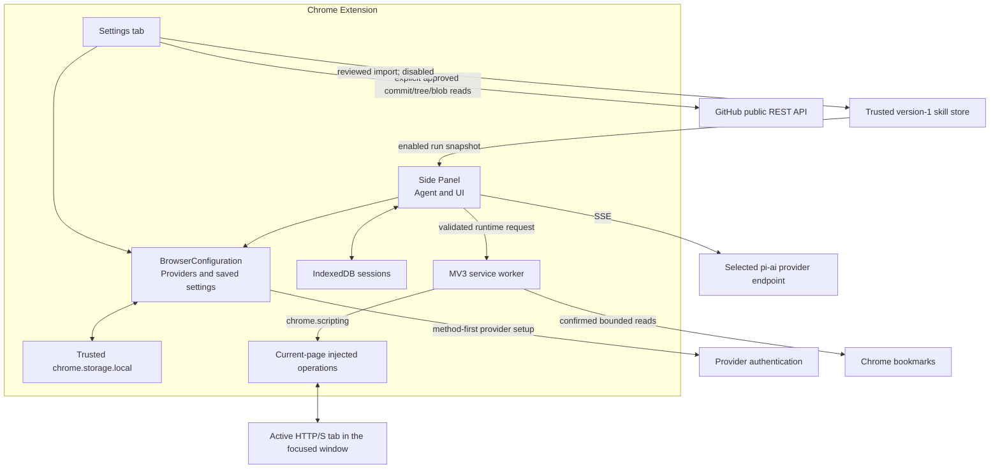

# Architecture

Pi Browser Agent has two trusted extension runtimes and no local companion process.

## Ownership

### Side Panel

The Side Panel entry routes conversation, full-tab Settings, and microphone-access views to separate initializers. The conversation view owns the live `Agent`, model stream, confirmation UI, queue controls, active session, unsent selected-element chips, and unsent composer images. It also owns per-turn page access: sending from a protected page requests only the provider endpoint and suppresses page tools, including queued instructions and later external tab switches, unless the agent explicitly switches to or opens a web tab. The agent can list bounded HTTP(S) tab metadata, switch tabs, or open an HTTP(S) URL with user confirmation and site access. It can also answer without a page. None of these actions reads a tab in the background. Settings owns general drafts for provider/model/thinking level, confirmation mode, tool preferences, language, appearance, and instructions; both views use the same credential UI controller. Credential setup selects an authentication method first, then filters the sanitized browser provider catalog to matching methods before passing the explicit provider and auth type to `pi-ai`; adding a credential does not change model selection. The Side Panel registers browser-compatible `pi-ai` providers, strips their Node-only OAuth paths, and replaces OpenAI Codex OAuth with the browser device flow. It requests optional screenshot or bookmark access only from the corresponding Confirm-button gesture. Element selection requests exact current-site access directly from its button gesture. Explicit Send, login, site-access, catalog-load, GitHub-fetch, element-selection, and cross-origin confirmation actions record app approval for their normalized exact origins. A profile-wide Web Lock serializes approval updates across the Side Panel and Settings tabs. `pi-agent-core` receives `transport: "sse"`; browser WebSocket transport is not used.

`BrowserConfiguration` (`src/browser/configuration.ts`) owns the credential store, browser model catalog, provider summaries, saved settings, authentication changes, and endpoint resolution. Settings uses it directly and creates no Agent, session store, or session lease. Each conversation runtime composes its own configuration instance and supplies a credential-removal hook that aborts the Agent and waits for persistence. Authentication changes remain serialized per instance; the credential store separately serializes writes across contexts.

The configured model and thinking level, active conversation selection, and Settings draft selection are distinct. Configuration initialization returns a model selection without applying it to a conversation. Settings can seed its selection from the opener's active model without changing saved configuration. Only the opener applies an explicitly changed model or thinking level to its active session (after a running response finishes); other conversations load the settings but retain their current selections. New sessions use the latest loaded configured model and thinking level.

Closing the panel aborts the active agent. Complete messages and tool results are persisted at event barriers. Shutdown retains its final save after the end listener: it can recover a failed listener save and mark a run interrupted if closing raced with an idle save. The session lease is released only after that final save attempt. A record left in `running` state is changed to `interrupted` on the next startup and is never continued automatically.

### Settings interface

`src/browser/sidepanel/settings-page.ts` initializes Settings independently in a full browser tab. Files in this section are under `src/browser/sidepanel/` unless stated otherwise. `settings.css` defines a centered shell capped at 1080 px, with a 192 px navigation column and forms capped at 720 px on desktop. `settings-tabs.ts` uses vertical navigation with Up/Down at widths of at least 800 px, and horizontal scrolling tabs with Left/Right below that width. Home/End works in both layouts. All six panels stay mounted; only the selected panel is visible. Shared `styles.css` separates accent text from primary-button fill, hover, and foreground tokens in both color schemes.

General draft state and explicit opener model/thinking apply flags control **Save general settings**. The page sends only edited general fields and explicit model/thinking selections. `storage.saveSettings()` merges these updates with current stored preferences under the settings Web Lock; tool choices form one field. A persistent footer reports general changes, MCP drafts, and unimported skill reviews from their existing owners; it is not a second settings store. Save is disabled without general changes or explicit apply intent. Pending authentication, approval clearing, MCP, or Skills actions block general Save, Back, and Cancel. General Save and exit actions protect resource drafts but do not commit them. Independent resource, credential, and approval actions are not undone by Cancel. A confirmation-mode draft has no runtime effect; saving a changed mode clears approvals, while explicit clearing is immediate.

`AuthenticationController` supplies sanitized missing/configured status and Account/API key method for the selected provider, with **Add credential** or **Update credential**. This is configured-credential status, not a successful live request. Settings adds no removal flow. `BrowserConfiguration.getModels()` derives thinking levels from SDK `getSupportedThinkingLevels()` and intersects them with the existing six non-off stored levels. An empty intersection disables the control as **Not applicable**, retains the saved preference, and leaves thinking apply unset while permitting a model save. Explicit model/thinking changes with an unsupported choice require local correction; unrelated saves retain the preference. An explicit thinking draft survives a temporary model without thinking support; the final model determines whether that draft is applied. General save revalidates the actual model/thinking preference inside the settings write lock, before approval clearing or settings writes. A failed validation cancels the write and returns focus to the invalid control.

MCP and Skills controllers keep independent resource lists, editors, save actions, draft state, and busy state. MCP rows show name, endpoint, and Enabled/Disabled; Skills rows show name, description, and Enabled/Disabled. Native list buttons provide selection. MCP requires explicit **New server**, then **Save disconnected** before **Test and enable**; host access starts directly in the test-button gesture. Skills shows installed records before local-file or GitHub import/review and reveals review text/actions only after valid parsing. GitHub host access starts directly in the repository-fetch button gesture; selected-file review reads only the selected blob. Replacement requires a selected installed target; imports and replacements start disabled. Deleting an installed skill retains any unimported review and its draft warning. Existing token, revision, endpoint-approval, and untrusted-text boundaries remain unchanged.

`settings-tools.ts` groups browser tools under Read, Interact, Navigate, Bookmarks, and WebMCP with visible descriptions and optional technical IDs. Native radio cards present confirmation modes without changing approval policy. Appearance uses static sample user/assistant messages, code, and a tool result with the existing font variables. It creates no Agent or session store, loads no session data, and makes no network request, permission request, or storage write. Existing immediate font preview and confirmed-discard restoration remain unchanged. Language adds one validated field to the existing settings object. Layout and navigation add no runtime message, provider catalog, permission, or skill-execution capability.

### Interface localization

`src/browser/i18n/` owns bundled typed catalogs, locale matching, named parameters, and locale-aware plural forms. The shared entry initializes the selected language before routing a view. Static bindings capture only packaged HTML before controllers insert data; dynamic controllers own their labels. The document language changes, but layouts remain LTR. English is the default and direct fallback.

Language is a general-settings draft without preview and uses the same serialized field updates as other general preferences. Saved changes reach conversation and microphone views through existing storage notifications. A view defers relabeling while work or an interactive control is active. Renderer signatures include locale, while message identities, disclosure nodes, clipboard attempts, image nodes, focus, and reader scroll state remain separate from localization. An open Settings document retains its display language and drafts.

Confirmation callbacks carry an optional local presentation descriptor alongside the original English diagnostic and unchanged details. Only the descriptor is translated; authorization and approval identities do not depend on it. No translated text enters model or worker payloads. The worker reads only the language field for its app-owned context-menu label. A small title map and the pure locale resolver keep full interface catalogs out of worker startup; storage imports a parity-tested tool-ID list rather than executable tool declarations. Manifest labels use Chrome-native `_locales` catalogs and follow Chrome language independently. Provider-owned prompts and arbitrary diagnostics are not catalog inputs. See [locale rules and catalog boundaries](i18n.md).

### Slash commands

`sidepanel/slash-commands.ts` defines the fixed browser command names, argument rules, parser, and prefix matches. `slash-command-menu.ts` owns completion and active-option state; selection changes only composer text. The conversation page dispatches commands before prompt authentication, permissions, image-model checks, and MCP preparation. Unknown commands and unsupported arguments fail locally without including the arguments in error text. Escaped `//` input removes one slash and follows normal prompt submission.

Commands reuse the session, Settings, and authentication actions used by existing controls. They require an initialized, idle runtime and no composer attachments. The submission token prevents duplicate dispatch; runtime busy state includes MCP preparation, streaming, persistence, and final listener settlement. Action acceptance rechecks runtime/authentication state and the selected session/provider. Session controls are disabled during command execution; choosing a session from `/resume` also rechecks the idle guard. Authentication methods return acceptance or cancellation and keep their existing permission and credential flows. Commands do not enter model messages or queues and add no storage keys, permissions, or background protocol.

### Persistent conversation tree

`src/browser/sessions/session-tree.ts` owns bounded, immutable message nodes, parent links, active-path projection, safe continuation boundaries, and plain-text tree labels. An optional version-1 `tree` extends the existing schema-version-1 session record; the IndexedDB database version does not change. The leading system baseline is rebuilt from current configuration. Legacy sessions are converted only in memory for preview; the first successful navigation atomically saves their complete history as nodes plus the active transcript projection.

`BrowserAgentRuntime` synchronizes complete message suffixes onto only the active path. Navigation requires an idle, auth-stable, leased session and a current UI guard. The runtime drains pending saves, rejects unresolved save failures, validates the candidate, and saves it before replacing live context. A successful IndexedDB commit is the navigation commit point. Session mutation and prompt submission are locked during that write; shutdown and credential removal wait for it. Session retention cleanup is part of the same transaction, so cleanup failure cannot leave a committed path with a rejected navigation.

`sidepanel/session-tree-dialog.ts` owns the modal tree, roving focus, keyboard/pointer selection, active-path markers, and pending/error state. The conversation page rejects stale dialogs, unsent drafts, attachments, and busy operations; validates restored images before navigation; and resets volatile transcript presentation after a path change. Selecting a user node moves to its parent and restores an editable draft. Selecting a completed assistant or paired tool-result boundary moves after it. No selection calls the model, replays a tool, or restores a browser capability. Only the chosen path supplies a later explicit prompt; inactive branches remain local storage.

Tree records retain all branches within the existing 5 MB total-record limit and 5,000-node bound. Legacy automatic image/turn compaction does not run on tree-enabled records. Failed or oversized writes preserve the previous stored record and report the unsaved state. Older extension builds can read the active transcript projection but can drop inactive branches on save; preserve complete records before downgrade.

### Message presentation

`src/browser/sidepanel/message-rendering.ts` owns transcript presentation and volatile, active-session-scoped view state. Message identity uses role, timestamp, tool-result call ID, and a collision index; content-block positions identify disclosures across partial and completed responses. Unchanged message nodes remain attached, while updated disclosures retain their existing nodes and open state. Image blocks reuse validated image nodes across streaming updates. A valid completed `browser_capture_visible` image exposes a stable callback-driven annotation action; other images and failed results do not. `src/browser/sidepanel/screenshot-annotation.ts` owns the local bounded canvas, vector strokes, redraw, and PNG export. Attach routes the generated `Blob` through the same composer limits as pasted images and never changes the original tool result. The renderer restores focused controls and preserves reader scroll position unless already near the bottom. Switching sessions discards view state.

`src/browser/sidepanel/markdown.ts` is the single untrusted-HTML boundary: bundled Marked parses assistant prose with raw HTML escaped and image syntax reduced to text; DOMPurify allows only required presentation tags/attributes. A final URL check permits only absolute HTTP(S) links without embedded credentials. No remote image or script is loaded. Code and answer copy controls run only on user gesture and report pending, successful, or failed clipboard writes. Per-message/content-block controls retain that feedback across streaming updates; each click captures the current text, and older completions cannot overwrite a newer attempt. Switching sessions discards these controls with the rest of the view state. User/tool/thinking content uses `textContent`; raw messages, session storage, and model transport never contain rendered HTML or disclosure state.

### Live-page annotation

`src/browser/sidepanel/page-annotation.ts` owns the idle-only tool strip, Freehand/Arrow/Rectangle menu, color-swatch menu, vertical width popup, and local UI state. The strip appears beside the active pen and uses the pen toggle to stop. Width updates use native `change`, so a pointer drag stays active until release; Send remains blocked until the worker accepts the update. `src/browser/content/page-annotation.ts` owns the protected live canvas, Pointer Events, bounded mixed-mark history, freeze/resume, and cleanup. Pointer down snapshots the tool, color, width, and start point. Each shape replaces one temporary preview and commits two endpoints as one history item; Undo removes that item. A setting accepted while idle can arrive after pointer down; it changes only the next mark. Frozen or invalid setting updates reject, and failed updates restore the panel choice. `src/browser/runtime/page-annotation.ts` defines shared palette and geometry limits. Fixed validated `pageAnnotation.*` requests go through the worker; they are not model tools. The existing screenshot editor and queued-image flow remain separate and unchanged.

The worker binds a random token to the panel client, exact `TabContext`, and generation for five minutes. Sender, top-frame, ownership, revision, geometry, readability, permission, and before/after visible-context checks constrain capture. Bounded state notifications cannot authorize capture or submission. Serialized cleanup and a separate startup generation prevent late replies from reviving a cancelled surface or removing its replacement.

Explicit Send snapshots the session, text, image IDs, and drawing generation under one guard. After authentication, image-capability/capacity checks, and existing screenshot consent, the worker freezes a completed painted revision and directly captures the protected viewport. The raster includes marks and the required 1% shield tint; all controls stay in the panel. There is no input gap or screenshot-first editor. Capture adds one validated immutable-ID composer image, then awaits surface cleanup before agent execution. The acceptance boundary clears only submitted text and accepted image IDs. Safe capture failure can resume editing; later submission failure retains the PNG and text for manual retry without recapture. Unconfirmed cleanup blocks submission until removal is confirmed. Cleanup retains the original document target across worker restart and window changes; URL or epoch changes alone do not prove removal.

The live page can move beneath marks; there is no DOM tracking or change to page-owned content/layout/top-layer state. Context, scroll, viewport/zoom, protection, permission, expiry, disconnect, and restart changes invalidate drawing and pending submission. Tool choices and raw marks stay in memory; sent PNGs use ordinary transcript image storage without a schema change. The protected-capture proof verifies painted marks, zoom alignment, and input interception in Chrome. The submission guard also runs after asynchronous skill and MCP preparation; Escape before acceptance prevents provider dispatch. See [feature contract](page-annotation.md) and [acceptance](manual-acceptance.md#page-annotation-acceptance--2026-11-01).

### Region capture

`sidepanel/region-capture.ts` owns rectangle inputs, explicit Preview, static preview, Attach/Retake/Cancel, session binding, and preview object URLs. `content/region-capture.ts` owns a separate protected selection surface with no capture authority. `runtime/region-capture.ts` defines exact messages, bounded state, geometry, and ownership. `region-capture-worker.ts` binds client, immutable operation ID, random token, generation, and original tab context; cleanup is serialized. Drawing and region workers check occupied state before startup to prevent overlapping surfaces without waiting for each other's cleanup. The conversation also excludes picker, voice, commands, and session navigation and defers language changes while the region controller is occupied.

Numeric changes use one panel-local serialized queue. New committed values replace the pending rectangle; further typing clears an older queued snapshot. Version checks preserve newer and invalid drafts across update notifications and replies. Fields remain editable during numeric updates, but not during page dragging, capture, or cleanup. Preview requires the shown values to match the accepted rectangle with no update in progress. Failure drops the queue without automatic retry. A delayed start reply cannot replace an already accepted page rectangle with default field values.

Only fixed `regionCapture.start`, `update`, `capture`, and `stop` requests are accepted. A content state notification cannot authorize capture. Pre-dispatch denial/cancellation clears local ownership without injecting or stopping a nonexistent surface. Once start may have been dispatched, even a lost reply requires confirmed cleanup. Cancellation invalidates the generation before asynchronous cleanup; stale results cannot revive a selection or attach pixels.

Explicit Preview preflights model image support and composer capacity without provider access or credential setup. Existing screenshot consent remains separate. Freeze hides only the rectangle outline and waits two paints; input interception stays active. The existing capture helper returns its full-viewport PNG only to the worker-local region crop path. `region-crop.ts` validates the source header, decoded dimensions, and limits, then rounds crop edges inward using actual decoded dimensions. Only the bounded PNG crop returns to the panel. Bitmap/canvas cleanup runs on success and failure; the full source is not a runtime result or transcript item. `runtime/png.ts` supplies the pure header check also used by the unchanged screenshot editor.

Surface removal must be confirmed before static preview and Attach. Failed cleanup blocks Attach and Send; a retained crop can retry cleanup without recapture. A finished preview has no live page context and survives a later tab change, but not session replacement or disposal. Attach creates one ordinary immutable-ID composer image. Later submission and manual retry use the existing attachment acceptance boundary, without another capture. No session schema or permission changes. See [region capture](region-capture.md).

### Remote MCP clients

`src/browser/mcp/` owns endpoint policy, versioned configuration/token stores, the bundled SDK transport, interpreted schema validation, discovery, and tool adaptation. `mcp-settings.ts` owns server controls; `BrowserAgentRuntime` prepares a new MCP declaration snapshot before an explicitly submitted run. MCP tools are independent of page context and the browser-only tool preference list.

Connections live in the Side Panel. Each request rechecks the exact endpoint, configuration revision, Chrome permission, and token binding. Requests omit cookies and reject redirects. SDK callbacks cannot discover OAuth endpoints or resume/replay a dispatched call. Server instructions are not copied into the system prompt. Names, descriptions, schemas, and results remain untrusted data; only bounded declarations and text/JSON results reach the model.

Every call uses fresh confirmation, sequential execution, and `replay: "never"`. Storage and permission listeners invalidate clients and pending confirmations across trusted contexts. Runtime abort/session changes close local work; shutdown also removes listeners. Neither saved history nor startup recreates a connection. Details and compatibility evidence are in [remote MCP](mcp.md).

### Skill import and loading

`src/browser/skills/` owns the shared bounded YAML parser, GitHub discovery, the existing version-1 store, and run snapshots. `src/browser/sidepanel/skills-settings.ts` owns input, candidate selection, plain-text source review, cancellation, and explicit import/replacement. GitHub work runs in trusted Settings, not the service worker or the model runtime.

Repository input is validated `owner/repo` or an HTTPS `github.com` repository-root URL. After explicit approval for `https://api.github.com/*`, the importer resolves the default-branch commit with `commits?per_page=1`, reads the returned immutable tree SHA recursively, and lists root `SKILL.md` and `skills/**/SKILL.md` paths, including dot-directories. Only the selected immutable blob is fetched and Base64-decoded. Requests use fixed API URLs, omit cookies and credentials, reject redirects, and enforce streamed-byte, entry, candidate, and duration limits. Cancellation, source changes, disposal, or permission loss abort work; stale responses cannot replace a newer review. See [discovery and network limits](skills.md#github-import).

Local and GitHub input use the same parser and 65,536-byte source limit. It accepts required name/description strings and validated optional `license`, `compatibility`, `metadata`, and `allowed-tools`. YAML structure is limited to 8 container levels and 256 nodes; tags, anchors, aliases, duplicate keys, multiple documents, and unknown fields are rejected. The body remains unchanged, and normalized folded descriptions must meet the existing one-line, 512 UTF-16-unit limit.

Review shows complete original source, parsed fields, and warnings; GitHub review adds repository, path, commit, and a user-opened source link. Source identity and optional fields are review-only memory. Explicit import or replacement saves only name, description, and body into the existing disabled `{id,name,description,body,enabled}` record. Preview and network failures do not write skills. There is no store migration, persistent provenance, update tracking, supporting-file installation, or plugin execution.

`SkillRun` retains the existing enabled catalog and `skills_load({id})` contract. Catalogs disclose only ID, name, and description; requested bodies enter ordinary model history. Loading reads the run's local snapshot without a GitHub request. Import and enablement send no model request and grant no browser-tool authority. Store, catalog, and per-run load budgets are unchanged. See [format, storage, and disclosure](skills.md).

### Service worker

The worker owns current-tab tracking, the selection context menu, element-picker tokens, injected DOM operations, screenshots, navigation, the read-only bookmark adapter, and the WebMCP adapter. `app.getState` returns a UI-only page capability (`none`, `web`, `restricted`, `file`, or `pdf`) and a `TabContext` only for a supported HTTP(S) tab. The capability has a bounded display title, never a protected URL or file path. Tab changes between two protected pages emit updates even without a bound context. Known restricted origins and PDF/file paths are excluded; page reads, WebMCP, picker, screenshots, tab metadata/navigation, and context-menu selection persistence also verify the document type and scriptability before use, rejecting extensionless PDF responses. An HTTP(S) tab whose page injection is denied becomes unavailable until it navigates or reloads. It follows tab activation and focused-window changes, briefly rechecks transient focus gaps while Chrome hands focus between windows, clears the target for unsupported pages, and revalidates the visible tab before every page operation. The Side Panel requests optional host, screenshot, or bookmark permissions directly from the corresponding user gesture; the worker verifies those grants before protected operations. Ordinary host checks require both Chrome permission and the app-approved exact-origin list, so screenshot `<all_urls>` access cannot independently authorize a new destination. Screenshot capture requires the optional `<all_urls>` grant because Chrome's temporary `activeTab` access does not follow tab switches, but the worker still accepts only the active visible HTTP(S) context. Picker start binds a random one-minute token to the exact tab ID, URL, and epoch. Only an extension sender from the top frame can return a bounded result, and selection consumes the token. Navigation, activation, focus loss, timeout, stop, or restart cleanup invalidates it. The worker accepts only the methods and JSON shapes listed in `src/browser/runtime/messages.ts`. Page operations compare their captured tab ID, URL, and context epoch with the current context; profile-scoped bookmark reads reject a tab context and are independently confirmation- and permission-gated.

`src/browser/element-picker-shortcut.ts` registers the `toggle-element-picker` Chrome command and calls `sidePanel.open()` directly from its user gesture. It retains at most one in-memory command intent for 10 seconds, scoped to the invoking tab, URL, and window. A ready conversation connects through a named runtime port; the worker checks the extension sender and exact panel path, validates the visible target, and sends a toggle with a random ID and current tab context. The panel acknowledges before processing and deduplicates IDs. Two presses before delivery cancel the pending start. Navigation of the target, tab/window changes, expiry, panel disconnect, and worker restart discard pending work. A disconnected panel cancels its own window's pending start as well as its active picker. A pending start records disconnects before its window lookup completes, then checks the result against its owner. Worker cleanup operations share a queue; starts wait for that queue before injection, so delayed navigation cleanup cannot remove a replacement picker. The conversation reconnects after worker suspension. If selection is active or starting, it requests worker cleanup and keeps the active UI until that request completes. An idle disconnect does not request picker cleanup. A reconnect never replays a consumed command. This port protocol is separate from the request methods in `runtime/messages.ts`.

Picker startup records its target before asynchronous lookup and permission checks. Only navigation of that target invalidates startup; unrelated-tab loading, URL changes, and title-only updates do not. Target navigation (including same-URL reload), tab/window changes, concurrent stop, panel disconnect, and worker replacement still invalidate pending work.

`src/browser/sidepanel/element-picker-shortcut.ts` owns the ready connection and assigned-key lookup. The conversation shares its button toggle with command delivery, checks busy and attachment limits directly, refreshes page eligibility before starting, and uses a generation counter to cancel pending starts. A new start waits for any previous stop to complete, so an older cleanup cannot remove its overlay. Local active and starting state retains its target context; a command for another target replaces the old picker instead of only cancelling it. Stop requests refresh the worker context so they do not reuse a pre-restart epoch. Shortcut starts require the delivered tab ID, URL, and epoch to match both before and after permission lookup; button permission prompts can still change the epoch without changing the target URL. Command delivery checks existing Chrome and exact-origin approval without requesting permissions or recording approval. Missing access produces an explicit picker-button action. That click captures the current page as a fresh action, runs the existing permission flow, and checks that the page did not change during authorization. It does not reuse an old shortcut's pending target. Selection remains an unsent local attachment. No new permission or persistent storage key is added.

`parseRuntimeRequest()` returns a method-discriminated `RuntimeRequest` union, so dispatch and method-specific handlers use validated parameter types. `REQUEST_LIMITS` in the same module supplies shared tool-schema, parser, and bookmark-adapter bounds. Outgoing messages still cross the worker's parser; types are not a substitute for runtime validation. The bookmark adapter retains its direct-call validation (including trimming before its query-length check), and worker permission and freshness checks remain independent.

### Injected operations

`chrome.scripting.executeScript` executes fixed functions from the extension bundle. No arbitrary JavaScript is accepted. Injected functions receive operation names and JSON arguments, never provider credentials or session transcripts.

The element picker is a separate top-frame, light-DOM operation. It installs a manual non-modal top-layer popover inside the currently active top-frame light-DOM modal, or under `html` otherwise. The shield has a closed-shadow highlight/label and does not change page layout, root styles, or page-owned dialog/popover state. Important inline viewport styles resist page CSS. Computed ancestor zoom and a geometry probe on the owned surface compensate for CSS zoom without `currentCSSZoom`. The probe distinguishes legacy unzoomed DOM rectangles from current viewport rectangles; legacy element/text geometry is converted to viewport coordinates. The declared minimum remains Chrome 116. A 1% black painted background is required for out-of-process iframe (OOPIF) compositor input routing: a fully transparent region can be omitted from compositor hit testing.

Startup validates coverage and interception, takes top-frame keyboard focus, and waits for two `requestAnimationFrame` callbacks before reporting success. Cleanup releases the paint wait. An early result is acknowledged before the startup reply completes, so startup cannot clear its token/client before delivery. Target and visible-text hit tests use `document.elementsFromPoint()` and filter out the shield; they never disable interception. Selection extracts bounded visible text, accessibility fields, allowlisted attributes, viewport geometry, and a unique-at-capture CSS hint. It captures only the top-frame iframe wrapper, never iframe contents or shadow-owned controls. Input values, editable text, hidden text, full HTML, and URL credentials remain excluded.

A later child-document focus transfer, new modal/popover, fullscreen change, or shield protection loss stops selection. Setup failure reports **Could not protect element selection on this page. Reload the page and try again.** Unexpected protection loss reports **Element selection lost its protection. Select again, or reload the page.** Capture failure reports **Could not attach the selected element. Try another element.** These are fixed local messages without page content or raw exceptions. Normal Escape, toggle, and navigation cancellation stay quiet; client IDs and generation checks reject stale UI updates.

Cleanup is idempotent and owns the shield, focus handling, listeners, observer, animation frames, startup wait, and expiry timer. It restores prior page focus only if the shield still owns focus. A standalone stop injection also removes orphaned overlay nodes after worker restart. The shield blocks target activation and default click/navigation/submit behavior, but an earlier page-level capture listener can still observe an intercepted event. This is not browser-internal input isolation. The fix adds no permissions, dependencies, or persistent storage.

`page.listElements` scans at most 2,000 top-frame DOM elements and returns at most 50 viewport-visible controls and vertical scroll containers. Optional role/type filters use exact matching; name uses a case-sensitive literal substring. Matching-result offsets are bounded to 2,000. Result pagination (`hasMore`, optional `nextOffset`) is separate from traversal exhaustion (`scanTruncated`). Each discovery page replaces the snapshot; filters do not expand the traversal budget. Discovery and reference-based mutations require a sampled viewport point to hit the control itself or a descendant; an ancestor-only hit does not qualify, excluding controls clipped by overflow containers. Partially visible controls can qualify through an exposed sampled point. Discovery, reference mutations, and name collection also reject zero-opacity CSS filter functions on an element or its filtering ancestors, even when hit testing still succeeds. For slotted light-DOM controls, filter ancestry follows exposed `assignedSlot` links (including nested slot assignments), then parent elements and shadow hosts. This does not enumerate shadow-owned controls; closed-root slot assignments are not exposed by the standard DOM API. Filters on boxless `display: contents` ancestors, including default slots, do not affect rendering and are ignored. Filter checks include the nearest active `:modal`, `:popover-open`, or `:fullscreen` root, even inside a shadow tree, but exclude its outside filtering ancestors because their filters do not affect top-layer rendering. Merely having `open` or `popover` attributes does not create this boundary. Existing display/opacity ancestor checks and selector behavior are unchanged. Computed styles resolve numeric, percentage, and CSS-math opacity values; arbitrary SVG filter effects are not evaluated. Before parsing, computed filter strings longer than 4,096 UTF-16 units fail closed: controls or name sources with such a filter on themselves or a filtering ancestor are excluded. No prefix is treated as a complete filter. This caps parser input even for distinct controls sharing one large CSS declaration; it does not bound the browser's style computation or serialization. Filter visibility decisions are cached per element within each synchronous discovery or validation phase, including fingerprint name collection and click inspection. Each injected operation starts a fresh cache. Typing replaces it immediately after focus returns, before post-focus visibility and fingerprint checks, so page focus handlers cannot reuse pre-focus filter decisions. Legacy CSS-selector operations retain their existing visibility behavior. For directly slotted name text, filter ancestry starts at the text node's exposed `assignedSlot`, not its parent host; parent visibility and text-range hit checks still apply. Name collection checks each non-whitespace code point's DOM Range rectangles against the viewport and requires a sampled hit on its text parent, not a covering descendant or ancestor. A visible container alone does not expose its clipped text or a clipped suffix; whitespace still separates wrapped words. Each text lookup inspects at most 100 text nodes and 256 UTF-16 units, including invisible ranges, to bound layout work. Names use visible `aria-labelledby` text, `aria-label`, associated labels, visible non-editable text, then placeholder, capped at 256 characters; role text is capped at 64 characters. Password/file controls and associated labels are excluded; values, editable text, and full HTML are not collected. Traversal and name lookup are bounded. Structured discovery JSON is capped at 48 KB, reserving space within the 50 KB final untrusted tool-text budget.

Each discovery creates one random-ID snapshot. The isolated world stores actual DOM nodes, action metadata fingerprints, and form identity; page scripts cannot access this registry. The worker retains only volatile snapshot metadata tied to the exact tab context. Snapshot expiry is five minutes. A new discovery replaces the old snapshot; navigation, activation, and focus events invalidate worker metadata synchronously so competing asynchronous tab refreshes cannot keep an old reference alive. Worker restart also discards metadata.

Click/type accept either the legacy selector or both `snapshotId` and `ref`, never a mixture. The worker checks snapshot freshness before injection and again in the final mutation-target assertion, together with permissions and cancellation. The injected operation rejects detached/replaced nodes and changed action metadata, and rechecks visibility/editability. Fingerprints include the target's native `:disabled` state as well as its own attribute, so inherited fieldset changes require rediscovery; first-legend controls remain valid when their effective state is unchanged. Submit fingerprints use the effective submit control's resolved `formAction`, name/value payload, override attributes, encoding/validation settings, and associated form identity, including targets reached through labels or nested elements. Submitter name/value is isolated-world comparison state only; discovery results, errors, and persisted transcripts do not contain it, and editable field values are not inspected. Changing the document base URL cannot silently retarget an approved relative submit override. Focus-triggered control changes are revalidated before typing. Link inspection and the confirmed action resolve the same reference and retain destination-permission checks. A successful injected click/type result is retained if its own navigation invalidates the snapshot; it is not reported as a rejected mutation. Discovery, inspection, and cross-origin navigation authorization still require a fresh snapshot before the worker performs any deferred navigation. References in persisted transcripts are historical only; there is no fallback selector or mutation replay.

`page.scroll`, `page.selectOption`, and `page.getElementDetails` use the same validated bridge. Inner-container scrolling, selection, and details accept references only. Scrolling uses fixed instant native DOM scrolling and reports actual distance, boundaries, and outer viewport context. Every successful scroll or option selection deletes the isolated registry and worker snapshot, even when the target is already at a boundary or the option is already selected. Scroll/select operations use the same final mutation-target assertion as click/type, and retain successful results if their own page handlers navigate. Selection always requires fresh confirmation, uses the native selected-index setter, and emits input/change events; option metadata is part of isolated fingerprint revalidation. Details use existing name/visibility rules, native role mapping, bounded state, and geometry without field values. No native keyboard/pointer channel or debugger permission is added. Schemas, examples, and limitations are in [browser interaction tools](browser-interactions.md).

### Bounded browser action foundations

Tool declarations remain in `agent/browser-tools.ts`; strict discriminated requests and shared limits remain in `runtime/messages.ts`. The worker owns wait lifecycle and request context. Synchronous DOM search/probes, native option reads, and checked activation remain inside the fixed injected page operation. No new Chrome permission, persistent state, dependency, arbitrary-code channel, or regular-expression input is added.

`page.findText` searches rendered, non-editable light-DOM text within an optional first-match HTML scope. It collapses whitespace within each Text node and never matches across nodes or excluded/clipped runs. Both excluded and included text count toward 2,000 nodes and 100,000 source UTF-16 units. New query/text/name inputs are capped at 256 Unicode code points, role/type filters at 64, and search/wait selectors at 2,048, matching JSON Schema lengths. Existing selector contracts, returned names, snippets, and source offsets retain their UTF-16-unit semantics. Queries are literal and case-sensitive. At most 50 snippets and optional geometry fit within 48 KB. Match `start`/exclusive `end` count raw scope-traversal UTF-16 units, including excluded text; continuation `offset` counts non-overlapping matches. Neither is stable across DOM changes. Search does not scroll or create mutation references. Effective editable state, including `document.designMode`, is excluded. Text under non-default CSS `clip`, `clip-path`, or mask images on box-generating ancestors is excluded conservatively; the tool does not evaluate arbitrary clipping shapes. Hidden content visibility is excluded. Overflow uses client/padding geometry along exposed composed ancestors, including independent body scrollports. Rounded clips and non-axis-aligned/flipped/3D transforms fail closed; positive axis scales and translations remain supported. Boxless ancestors do not apply box-dependent effects; effective text visibility respects descendant overrides. Scope validation uses bounded geometry probes, not a whole-subtree Range.

`page.waitFor` accepts selector state or literal text presence, not both. The worker keeps the original `TabContext`, checks access/readability/freshness/cancellation before each fixed synchronous probe, and uses cancellable 250 ms polling delays. Default timeout is 5,000 ms, maximum 10,000 ms. `TIMEOUT` is distinct from injection denial; navigation or context change fails closed, not as a match in a replacement document. Waits and text search do not replace or renew snapshots. A synchronous worker generation counter records navigation, activation, and focus events, so returning to the same tab before the next probe cannot preserve an old wait. A runtime wait without an explicit context captures the initial active document once and uses it for every probe.

`page.getSelectOptions` uses the reference bridge and option fingerprint checks without snapshot invalidation. It rejects catalogs above 2,000 options and returns up to 50 labels, indices, effective disabled flags, and label-truncation flags within 48 KB. Hidden options/groups are excluded using hidden/ARIA-hidden and computed rendering metadata, which also enter fingerprint checks. Option offsets and continuations use native indices, not returned-entry counts. Raw values and selected-state fields never leave the isolated-world comparison state. Labels above 256 UTF-16 units are marked truncated, not advertised as exact selectable labels.

`page.setChecked` accepts native checkboxes and radio activation (`true` only). Supported already-matching states return without events or confirmation. Actual changes require fresh confirmation in every mode and revalidate the same node, checked state, radio group, metadata, visibility, access, context, and cancellation before one native DOM activation. Checkbox/radio payload values are private approval-comparison data and never returned to the model. Radio-group checks bind the root, form, name, actual member identities, and peer states; incomplete 2,000-element group scans fail closed. Every activation invalidates both registries. A handler-reverted state is reported without retry. Removal/navigation after activation can leave the final state unverified; the result does not imply that replay is safe. Mutation tools remain sequential with `replay: "never"`. See [exact interaction contracts](browser-interactions.md).

## Data flow

1. The user sends a prompt in the Side Panel, with the current page or with no page context.
2. The panel resolves or refreshes the selected provider credential through the serialized credential store.
3. `pi-ai` streams the selected provider/model response over SSE.
4. Valid tool arguments become typed runtime requests to the worker.
5. The worker revalidates tab context and safety conditions, then executes a bounded operation.
6. Results return to the Side Panel and are labeled as untrusted before model use.
7. The panel persists only complete transcript boundaries.

For screenshots, the worker first checks the optional `<all_urls>` grant. If it is absent, an operation-specific confirmation explains Chrome's broad capability and Pi Browser Agent's current-viewport limit; its Confirm gesture requests access, and the worker rechecks the grant before calling `chrome.tabs.captureVisibleTab()`. The PNG is capped at 3 MB, labeled untrusted, sent to the selected model provider, and persisted in the transcript. Annotation decodes that existing PNG locally into a dimension- and pixel-bounded canvas, stores bounded vector strokes for undo/clear, and exports a new PNG of at most 3 MB. The new raster remains an unsent composer image until Send/steer/follow-up and then follows normal provider and session handling.

For live-page drawing, explicit Send captures the protected page plus marks as one ordinary image, not a screenshot tool result. Cleanup must complete before that guarded prompt starts. See [live-page annotation ownership](#live-page-annotation) for failure and cancellation boundaries.

For region capture, Chrome first creates a full-viewport PNG in worker memory. The worker decodes and crops it before a runtime response; the source is neither attached nor stored. Preview and Attach make no provider request. A later explicit Send shares only the cropped attachment, alongside ordinary text/history and separately approved context. A crop is not a general boundary for all agent context.

For selected elements, the panel keeps up to five contexts and 16 KB only in memory until Send. Submission appends versioned JSON below an explicit untrusted-data header in the user message, including for element-only prompts, steering, and follow-ups. Sent context is therefore visible to the selected provider and persists as user-message text. CSS selectors and rectangles remain descriptive historical data; later mutations still require normal discovery, permission, confirmation, and freshness checks.

For bookmarks, the model can request only a bounded text search or recent-item read. The worker first requires an operation-specific confirmation; the panel may reuse one for the same operation, query, and limit when Chrome access remains granted. The confirmation gesture requests missing optional access, and the worker rechecks that access before calling `chrome.bookmarks.search()` or `chrome.bookmarks.getRecent()`. Normalized results are capped at 50 items and 50 KB, labeled untrusted, sent to the selected model provider as tool results, and persisted in the transcript.

For WebMCP, the panel captures tab context and confirms or finds a matching prior approval before sending one confirmed operation to the worker. Matching list approvals bind to the page URL; calls also bind to the tool name and canonical arguments. The worker then checks host access, and the injected adapter independently checks confirmation. This differs intentionally from tools that discover a confirmation requirement through an initial worker request; changing that sequence would change dialog and progress-event ordering. `src/browser/agent/confirmation-policy.ts` hashes bounded action identities into versioned ledgers: Strict does not reuse; Balanced stores fingerprints in `chrome.storage.session`; Convenient stores them in trusted `chrome.storage.local`. No raw arguments, queries, or full URLs are kept in the ledger. Changing the confirmation mode or selecting **Clear remembered approvals** clears both ledgers. Reuse only skips the app dialog: worker permission, stale-tab, and mutation-target checks remain mandatory, and no failed mutation is replayed.

The context-menu selection path starts from an explicit user click. It truncates the selection, labels it untrusted, and either places it in the composer or queues it as a follow-up to a running agent.

## Browser provider seam

`builtinProviders()` supplies the `pi-ai` chat catalogs and lazy response implementations. Pi Browser Agent excludes Amazon Bedrock because its implementation intentionally loads a Node-only AWS SDK module. It removes non-Codex OAuth objects because those flows intentionally load Node callback/PKCE modules; their API-key paths remain available. The authentication selector derives its choices only from this sanitized provider set, so an upstream Node-only OAuth method cannot appear in Chrome. `createBrowserCodexProvider()` replaces Codex's lazy Node OAuth object with the browser device-code implementation. OpenAI API keys remain on the separate `openai` provider. Azure setup additionally stores its endpoint and optional deployment mapping with the provider-scoped API-key credential.

The selected provider and model are persisted in settings and in every session. Before a request, the Side Panel derives the selected endpoint without exposing the credential, then asks Chrome for that exact optional host origin together with the visible page origin and records those exact app approvals. Chrome can suppress its native prompt after `<all_urls>` is granted, but Pi Browser Agent still requires this explicit Send gesture before ordinary access. Credentials and request-time OAuth refresh share `ChromeCredentialStore`, so all credential-map writes serialize through one cross-context Web Lock and rotated tokens are committed atomically.
