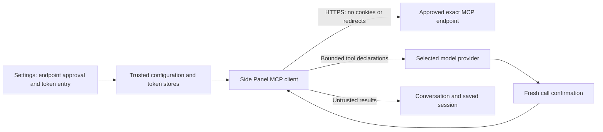

# Remote MCP

## Setup and use

1. Open **Settings → Remote MCP servers**.
2. Enter a name, a public HTTPS Streamable HTTP endpoint, and an optional bearer token of 16 to 4096 characters without spaces. Shorter tokens are rejected before storage or a connection. Replace or remove any older short token in Settings. Do not put credentials in the URL. Query strings and fragments are not supported.
3. Select **Save disconnected**. These controls save immediately, independently of **Save settings** or **Cancel** for other preferences.
4. Select **Connect and preview** to approve that exact endpoint and request Chrome host access. Review the plain-text tool preview. The server stays disabled during preview. Only successful discovery and cleanup can publish enablement. A failed test leaves it disabled. Preview access can discover tools and close its session, but cannot call a tool.
5. Send a prompt. Each new run discovers enabled servers again. Review the endpoint, tool name, and complete arguments before confirming each call.

MCP works without a readable page. Browser-tool checkboxes do not control MCP tools. Every MCP call requires fresh confirmation in Strict, Balanced, and Convenient. Server read-only annotations do not remove this requirement.

Edit a selected server and save to disconnect it and invalidate its previous declarations. A blank token field keeps an existing token only at the same endpoint; **Remove existing token** deletes it. Changing the endpoint, including its port or path, never transfers the old token automatically. Edits and removals must match the saved revision. A stale Settings tab cannot replace or delete newer data or tokens; reload it before making a change. Starting a preview or disabling a server gives it a new revision. A later edit, disablement, or removal blocks an older preview from enabling it. Local validation errors state what must be corrected without showing input values. Reconnect after any edit. **Disable** blocks future calls but retains the configuration and token. **Remove server and token** deletes both and the endpoint connection approval.

## Supported protocol

The packaged client is `@modelcontextprotocol/sdk@1.32.1`. It negotiates Streamable HTTP versions `2025-11-25`, `2025-06-18`, and `2025-03-26`. The transport accepts JSON and SSE responses to POST requests. It does not open standalone GET streams, resume broken SSE streams, or retry a dispatched tool call. Servers must finish each response within the operation deadline and byte limit. Responses are buffered with limits before the SDK parses them.

The client supports unauthenticated servers or one explicitly entered bearer token. It does not use cookies, follow redirects, perform OAuth, discover authorization servers, or use provider credentials for MCP.

Unsupported features include stdio, loopback/private-hostname endpoints, Native Messaging, legacy HTTP+SSE, resources, prompts, sampling, elicitation, roots, task-required tools, and executable plugins. MCP tool results support text blocks and structured JSON only. Images, audio, embedded resources, and resource links fail without fetching a referenced URL.

WebMCP remains separate: a web page supplies WebMCP tools through the browser, while remote MCP connects directly to a configured server.

## Schema compatibility and limits

Input schemas must have an object root. Input and optional output schemas use an interpreted JSON Schema subset:

- One scalar `type`: object, array, string, number, integer, boolean, or null.
- Object `properties`, `required`, and Boolean `additionalProperties`.
- Array `items`, `minItems`, and `maxItems`.
- String `minLength` and `maxLength`; numeric `minimum` and `maximum`.
- `enum`, `const`, and descriptive `title`, `description`, `$schema`, and `default` annotations.
  - Defaults are not applied.
  - References, regex patterns, formats, composition keywords, type unions, and schema-valued additional properties are rejected.
  - No schema code is generated or fetched.

| Boundary | Limit |
| --- | --- |
| Configured servers | 8 |
| Tools | 32 per server and 32 across one run |
| Discovery pages | 4 per server; repeated cursors fail |
| Schema | 16 KiB each; 8 nested schema levels |
| Tool name and description | 64 ASCII name characters; 2,048 description UTF-16 units |
| Combined MCP declarations | 64 KiB per run |
| Request body | 16 KiB, including JSON-RPC fields |
| Response body | 256 KiB of decoded bytes, counted during reading |
| Tool result | 48 KiB; unsupported or oversized results fail instead of being truncated |
| JSON data nesting | 16 levels |
| Operation deadline | 15 seconds for discovery or one call, including response reading |
| Graceful session cleanup | 2 seconds; one authorized DELETE, with no retry |

## Ownership and authorization

Connection approval binds the full normalized endpoint, a stable server ID, and its configuration revision. Chrome host patterns do not encode ports or endpoint paths; they are an additional requirement, not a substitute for this approval. The broad screenshot grant alone is not MCP consent.

Clients and declarations belong to a panel and a run. No client or token enters the service worker or page context. Closing the panel, stopping the run, changing MCP configuration, or revoking a host permission cancels local MCP work. MCP configuration changes conservatively invalidate all MCP clients in that panel. Tool definitions change only after discovery for a later run. Startup and session restoration do not connect or replay calls. Failed or cancelled discovery keeps the unsent text, images, and element chips in the composer. Acceptance removes only the submitted attachments and unchanged text; text edited during discovery stays in the composer.

Tokens use a separate trusted storage key and are not included in public server configuration, model messages, tool results, transcripts, or diagnostics. Server error text is replaced by a fixed error. Responses that echo the known token are rejected before metadata or results leave the client, including JSON-escaped echoes. A malicious server already receives its configured token and can misuse or encode it; use a dedicated least-privilege token.

## Failure and recovery

A network failure, authentication error, unsupported schema/protocol, expired session, denied confirmation, oversized response, or revoked permission cannot trigger a fallback destination or automatic call retry. On an expired session, a later explicit connection or run can create a new discovery session; an uncertain tool call is never replayed.

A successful preview and a completed run use the SDK session-termination request before closing an idle stateful connection. Cleanup rechecks the exact endpoint, revision, and host grant, omits cookies, rejects redirects, and stops after two seconds. Cleanup is best effort. Revocation, configuration changes, or interrupted execution close locally without a new request. The server must expire sessions that could not be terminated.

API-only permission removals do not stop MCP. Origin removals recheck the MCP endpoint grant. An unrelated site grant or a broader grant can be removed without stopping MCP if endpoint access remains valid. If access is lost or cannot be checked, the current connection closes.

Cancellation cannot undo remote side effects. Review server state before requesting another call. Disable an unavailable server to continue ordinary chat without it. Revoking Chrome permission retains the token but prevents requests until access is approved again.

Deleting sessions does not remove MCP settings or tokens. Remove servers individually before downgrading to a build without MCP controls. An older build ignores the two new storage keys; uninstalling the extension removes extension storage. Deleting local records cannot delete data already held by a remote server or model provider.

Public hostname validation rejects IP literals and known local/private hostname forms. It does not resolve DNS and cannot prevent a public name from resolving to a private address. Servers must validate extension origins and protect their endpoints against DNS rebinding. Some servers reject extension-origin requests even with Chrome permission; the extension reports this failure and does not add a proxy.

## Compatibility evidence

The browser-boundary probe includes the SDK client and Streamable HTTP transport. The production artifact retains the existing Node, loopback bridge, remote-script, and required-host-permission bans.

`tests/e2e/remote-mcp.spec.ts` and `remote-mcp-lifecycle.spec.ts` use a real HTTPS server and the production extension in Chromium. They cover JSON/SSE, session headers, origin denial, redirect rejection, cookie omission, confirmation, no-page use, token separation, configuration invalidation, host permission revocation, cancellation, and restart without replay. Test-only certificates, hostname mapping, and certificate bypass remain outside the production artifact.

### Validation environment

The first implementation passed the complete suite on Chrome 153. The default Chromium 156 run exposed an older WebMCP argument-format failure, also reproduced on base commit `6e6c22f`. The review fix now selects the native argument format from the registered schema shape before the call. It does not probe or retry execution. The native smoke test remains enabled.

Review validation covers both browser API formats and the remote MCP boundaries. See [the PR review ledger](reviews/pr-98-review.md) for current checks. Stable-Chrome Side Panel layout, native permission dialogs, and external production MCP services were not manually tested.

Protocol references used for implementation:

- [Official Streamable HTTP specification](https://modelcontextprotocol.io/specification/2025-11-25/basic/transports)
- [Official lifecycle specification](https://modelcontextprotocol.io/specification/2025-11-25/basic/lifecycle)
- [Official TypeScript SDK transport](https://github.com/modelcontextprotocol/typescript-sdk/blob/v1.x/src/client/streamableHttp.ts)
